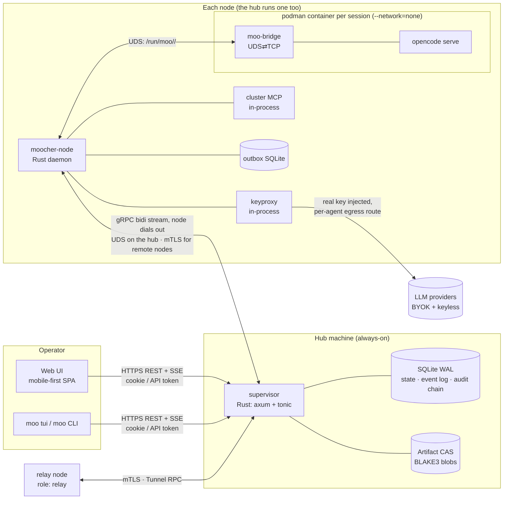
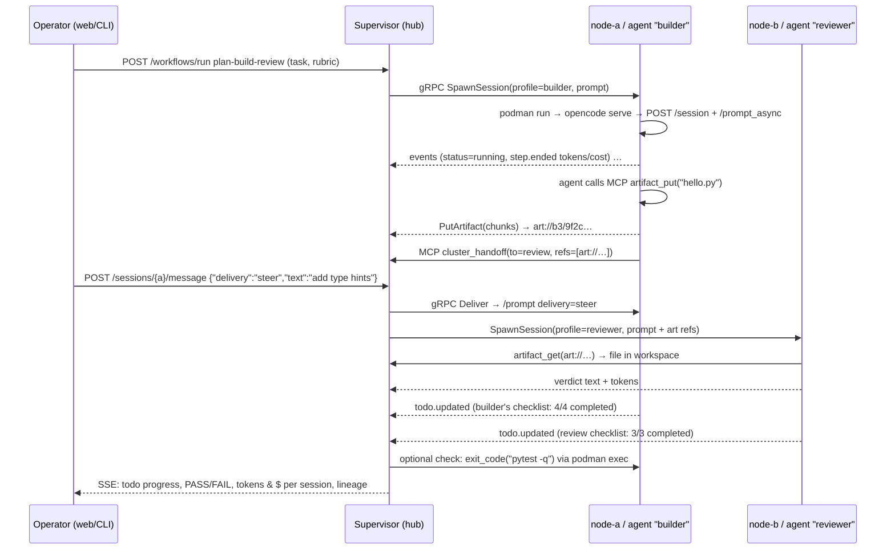

# moocher — Architecture (v1, after Phase 4)

> Status: Phases 1–4 implemented and verified end to end (see [`PHASE1.md`](./PHASE1.md), [`PHASE2.md`](./PHASE2.md), [`PHASE3.md`](./PHASE3.md), [`PHASE4.md`](./PHASE4.md)). Operations: [`RUNBOOK.md`](./RUNBOOK.md). Phase 0 notes: [`PHASE0.md`](./PHASE0.md). Running it: [`QUICKSTART.md`](./QUICKSTART.md). Config reference: [`CONFIG.md`](./CONFIG.md). Design additions (reviewed): [`PHASE1_5.md`](./PHASE1_5.md) (§12).
> Sections marked **(Phase N)** describe designed-but-not-yet-built parts.

## 1. Goals in one paragraph

Turn OpenCode instances spread across several Linux machines into one cluster you can watch and control. A secret-free **supervisor** on an always-on hub decides what runs where. A small Rust **node daemon** on every machine runs OpenCode sessions inside **rootless Podman containers**. Provider keys stay on the node in a **credential-injecting LLM proxy**, so neither the supervisor nor the agent ever holds a real key. Agents talk to the cluster (send messages, exchange artifacts, spawn sessions) through an **MCP server** that the node daemon provides.

## 2. Components



| Component | Lang | Responsibility | Budget |
|---|---|---|---|
| `supervisor/` | Rust (tokio, axum, tonic, rusqlite) | Registry of nodes/agents/sessions, orchestration engine (workflows + mailboxes), artifact CAS, evaluator dispatch, operator REST/SSE API, auth, audit log, `/metrics`. **Holds no provider secrets.** | < 60 MB RSS |
| `node-daemon/` (`moocher-node`) | Rust | Reads `~/.moocher/` (hot reload), manages Podman containers (podman CLI), drives OpenCode over its HTTP API, follows its event bus, runs **keyproxy** and **cluster MCP**, keeps an outbox and replays it after supervisor outages, reconciles on its own restart. | < 40 MB RSS (OpenCode containers excluded; ~420 MB each, measured) |
| `moo-bridge` | Rust, static musl, ~1 MB | Runs inside each container. Forwards UDS ⇄ loopback TCP in both directions, so the container needs **no network at all**. | negligible |
| `shared-protocol/` | protobuf + Rust crate | gRPC node⇄supervisor envelope + JSON payload enums, REST DTOs, config schema with JSON Schema output (`moocher-node schema`). | — |
| `ui/web` ✔ | SolidJS + Tailwind v4 + Kobalte (Vite), built into `supervisor/ui-dist` and embedded (rust-embed) | Mobile-first PWA dashboard: every view in PHASE1_5 §13c, live over SSE, Web Push service worker. | ~85 KB gz total (43 KB first load) |
| `cli/` (`moo`, `moo tui`, `moo attach`) ✔ | Rust (clap; ratatui) | Same actions as the web UI, for scripting and for SSH-only use. | — |

## 3. Key design decisions

**D1 — Session control uses OpenCode's own server API; the only shim is transport.** Verified against OpenCode **1.19.4** in Phase 1:
- Sessions are created and prompted through the **v1 session API** (`POST /session`, `POST /session/{id}/prompt_async`, `POST /session/{id}/abort`). The newer v2 runner (`/api/session/*`, durable replayable events) does **not expose MCP tools yet** in 1.19.4, and agents need the cluster MCP tools. We switch to v2 once it does.
- Telemetry comes from the v1 instance bus `GET /event`: `session.status` / `session.idle` (busy/idle), `todo.updated`, `message.updated` (per-step `tokens{input,output,reasoning,cache}` and `cost`), tool parts, `permission.*`.
- **Nothing is lost on reconnect:** after every (re)connect the node rebuilds usage, output and todos from `GET /session/{id}/message` and `/todo`. Usage is kept per assistant message id, so replays never double count.
- A message sent while the agent is busy is picked up **at its next step**. That is a native mid-run command.
- Startup quirks handled by the node:
  - config is loaded via `OPENCODE_CONFIG_DIR` (read-only mount, with a pre-created `.gitignore`);
  - `OPENCODE_DISABLE_PROJECT_CONFIG=1`, so an agent cannot rewrite its own permissions;
  - the node waits for its model to appear in `/api/model` before the first prompt.

`moo-bridge` is the only shim, and it handles transport only. The endpoints we use are listed in `node-daemon/src/oc.rs` and unit-tested against the pinned version's OpenAPI paths.

**D2 — The agent never sees a real key (keyproxy).** You asked for this. Each container's `opencode.json` points every provider's `baseURL` at `http://127.0.0.1:7777/llm/<provider>` (bridge → node UDS). The `apiKey` is a **capability token**: per session, revocable, with a budget. The keyproxy is a header-rewriting reverse proxy that passes the body through unchanged, so OpenAI-compatible, Anthropic and Gemini wire formats all work. For each request it:
1. checks the capability against the session's model allowlist and token/USD budget;
2. reads the real key from the node secret backend;
3. strips the capability and adds the provider's auth (`Authorization`, `x-api-key`, `?key=`, or nothing for keyless gateways);
4. sends the request through the agent's **egress route** (see D10), for example out through another machine so the provider sees that machine's IP;
5. parses usage from the response or stream as a **second, authoritative meter** for budgets.

The supervisor, the UI and other nodes only ever see *secret references* by name.

**D3 — Agents act on the cluster through MCP, not a custom plugin.** The node serves a per-session MCP endpoint (streamable HTTP, reached through the bridge, authenticated by the same capability). OpenCode exposes its tools as `cluster_<name>`:

| Tool | Who |
|---|---|
| `send_message`, `read_inbox`, `list_agents`, `list_sessions`, `session_status` | every session |
| `ask`, `answer`, `escalate`, `questions`, `report_up`, `log_assumption` | every session (questions, §6c) |
| `artifact_put`, `artifact_get`, `artifact_list`, `artifact_info`, `sync_workspace` | every session (artifact bytes move on the node, next to the workspace) |
| `spawn_agent`, `stop_session`, `task_get`, `task_note`, `task_complete`, `task_fail` | coordinator sessions only (enforced on the node *and* the supervisor). The operator can start a coordinator without a task (`moo spawn --coordinator`). |

This is the "programmatic way" for an agent to start sessions without secrets: it names a **profile**, and the node that owns the key does the rest. OpenCode's native MCP support means nothing has to be compiled into OpenCode. An `agent.tools.cluster` allowlist can narrow the set per profile.

**D4 — Transports, each used where it fits best.**

| Hop | Transport | Why |
|---|---|---|
| node ⇄ supervisor | **gRPC bidirectional stream**, dialed by the node: a 0600 unix socket on the hub and **mTLS** over TCP for remote nodes (plus `Enroll` and `Tunnel` RPCs on the same port) | Typed, multiplexed and small. Commands go down and telemetry goes up on one connection. Works through NAT with no inbound ports on workers. |
| operator ⇄ supervisor | **HTTPS REST/JSON + SSE** | Works in a phone browser, `curl` and the CLI. SSE is enough for one-way live updates. |
| node ⇄ OpenCode | OpenCode HTTP + SSE (`/event`) over UDS | Upstream's native interface. |
| agent ⇄ cluster | MCP (streamable HTTP) over UDS | Native in OpenCode and works with any model. |
| message bus | **None (NATS rejected)** | Hub-and-spoke with one supervisor doesn't need a broker. Fewer daemons on 8 GB machines. NATS is the upgrade path if we ever run several supervisors. |

**D5 — Node identity uses mTLS, bootstrapped by a one-time token.** Implemented in Phase 2:
1. `moo node invite <name> [--relay]` creates a join token `moojoin.<secret>.<CA fingerprint>`. It is single use, expires after 15 minutes, and is bound to that name and role.
2. `moocher-node join https://hub:7443 --token …` creates an Ed25519 key **on the node**. It connects with a TLS verifier that only accepts a server whose chain contains the CA with that fingerprint, then sends a CSR with the token over the `Enroll` RPC.
3. The supervisor's private CA (rcgen, Ed25519) signs a 30-day client certificate. The hub decides the name and ignores whatever the CSR asked for. It records the certificate's **SHA-256 fingerprint → node**, so identity is a lookup and revocation is one row. Nodes renew over the live stream at two thirds of the lifetime, with a fresh key each time.
4. One TLS port serves both: client certificates are *optional* at the TLS layer (so `Enroll` works), and every other RPC requires an enrolled, unrevoked, approved certificate whose name matches the node's hello. The TLS listener passes peer address and certificate fingerprint into each handler.

We chose this over a pre-shared bearer token because:
- the long-lived credential (the private key) never leaves the node;
- TLS gives encryption and identity in one handshake;
- revocation is a single-row CRL check;
- a leaked enrollment token is useless after first use.

The operator UI uses ordinary server TLS (rustls; ACME, or a supervisor-CA certificate the operator trusts).

**Adding a machine (API and CLI in Phase 2, web UI in Phase 4), as requested:**
1. The operator (admin scope) runs `moo node invite <name> [--relay]`, or uses **Nodes → Add machine** in the dashboard (admin scope). The API is `POST /api/v1/nodes/invite`.
2. The reply carries a one-time join token (single use, 15 min, bound to that name and role) and a copy-paste command: `moocher-node join https://hub:7443 --token moojoin.…`.
3. The new machine generates its key locally, sends the CSR with the token, and receives its certificate plus the hub's CA. Then it starts `moocher-node` under systemd.
4. The node shows up as **pending approval**. The operator approves it with `moo node approve <name>` (or **Approve** in the dashboard; approval is optional and on by default). From then on its agents are eligible.
5. Revoking a node (`moo node revoke`) flags its certificates and closes its stream immediately.

Every step is in the audit log. The token is useless after first use or once expired, and a leaked token can only enroll the name it was issued for, which is still subject to approval.

**D6 — Operator authentication uses a password, a cookie and optional TOTP, plus API tokens for the CLI.** (Implemented in Phase 4.)
- **Password:** hashed with Argon2id; users have the same `read|operate|admin` scopes as tokens (`moocher-hub user set`).
- **Session cookie:** a random token kept only as its SHA-256; `HttpOnly; SameSite=Strict`, `Secure` over HTTPS; a CSRF token (`X-CSRF-Token`) on every change.
- **TOTP:** optional (RFC 6238), each code accepted once.
- **Lockouts:** per account and per source IP, doubling up to 24 h, with vital notifications; everything audited.
- **CLI:** API tokens scoped to `read|operate|admin`.
- **HTTPS:** rustls with a certificate from files or ACME HTTP-01 (instant-acme), hot-swapped on renewal; or a reverse proxy with `trusted_proxies`.
- **Open in OpenCode:** a second origin (`attach_listen`); one-time ticket → cookie; the hub splices each browser connection through a node tunnel to an HTTP proxy on the node, which checks the cookie hash on every request and adds the container's OpenCode password.

We chose this over OAuth because there is one trusted operator, everything is self-hosted, and the hub must keep working without an external IdP. Users and roles are already modelled, so OIDC can be added later as a login provider when we go multi-user.

**D7 — Every OpenCode session runs in its own Podman container.** One session per container gives every session a clean identity: its own capability token, MCP identity and budget. The cost is RAM: OpenCode measured **~420 MB RSS idle** per container. Packing several sessions into one container is possible later, but a container cannot tell which of its sessions made an MCP call, so it is not the default. Containers run:
- `--network=none`, `--cap-drop=all`, `--security-opt=no-new-privileges`, read-only rootfs, `--init`;
- rootless with `--userns=keep-id:uid=1000`, or rootful with host dirs chowned to uid 1000;
- with `--memory/--cpus/--pids-limit` taken from config;
- with mounts: workspace, OpenCode home (so sessions survive a container restart), generated config read-only at `/etc/moo`, and the socket dir at `/run/moo`;
- with labels `moo.node`, `moo.session`, `moo.agent` for rediscovery.

`container.egress: full` gives an agent normal networking (package installs, webfetch). `egress: allowlist` keeps `--network=none` and lets HTTP(S) through a per-instance proxy on the node, to `allow_hosts` only (USAGE §29). The image is built from `images/agent/Containerfile`: OpenCode from npm (pinned) plus `moo-bridge`, git, python3 and pytest. The base image is configurable.

**D8 — Durability works the same way at every level: desired state, observed state, reconcile.**
- **Supervisor restart:** containers keep running, and nodes keep buffering events in their outbox. Each node reconnects with a full **inventory snapshot**, and the supervisor reconciles it against SQLite. Unknown sessions are adopted; missing ones are marked `lost`, which the recovery policy treats as a death (§7a). An instance that was replaced while its node was away is stopped when the node returns. **Nothing is orphaned.**
- **Node restart:** the node runs `podman ps --filter label=moo.node=<me>`, restarts stopped containers, re-attaches gateway and event stream, and resyncs each session from OpenCode's message history. Verified in Phase 1, including a node restart in the middle of a workflow.
- **Outbox:** sequence-numbered and acknowledged by the supervisor. Reconnect uses exponential backoff with full jitter (0.5 s → 60 s).

**D9 — The hub runs its own sessions.** The hub (the always-on machine with the supervisor) also runs `moocher-node`, connected over a local unix socket. Both share the hub's config directory (`supervisor.yaml` + `node.yaml` + `agents/`). Lower the hub's `max_sessions` if it should mostly coordinate.

**D10 — Egress routes: what IP the LLM provider sees.** A *route* only affects the keyproxy's outbound calls to the LLM provider. It doesn't change agent tools or cluster traffic.

```yaml
# routes.yaml
routes:
  direct:      { type: direct }                    # default: this machine's IP
  via-vps-de:  { type: via_node, node: vps-de }    # out through another cluster node
  my-proxy:    { type: proxy, url: socks5h://10.0.0.5:1080 }   # any SOCKS5/HTTP proxy (e.g. `ssh -D`)
```

- **`via_node`** is what you asked for, and is implemented in Phase 2:
  1. keyproxy sends the request through a local SOCKS5 entry point. It listens on 127.0.0.1 and needs a per-daemon password; the username names the relay.
  2. That opens a `Tunnel` RPC to the hub: `Dial{relay, host, port}`.
  3. The hub asks the relay (`OpenTunnel`). The relay connects to the provider from its own IP (or from `egress_bind`) and opens its own `Tunnel` RPC with `Accept{id}`.
  4. The hub joins the two streams.

  TLS to the provider is **end to end**, so the hub and the relay see only encrypted bytes, and the API key stays on the original node. Relays only dial out. A relay can be a worker with `relay: true`, or a machine with `role: relay` that runs no agents. Each relay limits destinations with `relay_ports` (default 443) and `relay_allow_hosts`.
- **`proxy`** points at any existing proxy.
- Routes are chosen per agent (`route:` in the agent YAML), and `node.yaml` can set a node default.
- **Failover plans:** `route: { prefer: direct, failover: [via-vps-de, home], on_exhausted: wait }`.
  - Keyproxy skips routes whose quota bucket is exhausted.
  - It retries a 429, or an unreachable route, on the next route before anything has reached OpenCode.
  - When every route is used up, it answers 429 with `retry-after` until the soonest reset. The session shows `parked` with a countdown, and OpenCode resumes by itself.
- **Quota buckets** are kept per provider and per egress IP, key, or account label. They are learned from rate-limit headers, `retry-after` and 429s, or from configured windows, and merged across nodes at the hub (CONFIG `quota:`).
- **Egress IPs** come from the hub-observed link address or an `ip_echo` probe through each route.
- **Relay admission:** relay-only nodes must connect from an allowed source (`moo allow`).

## 4. Data flow — two-agent handoff (target design)

Everything here is implemented: Phase 1 ran it on one node with a shared workspace, Phase 2 added cross-machine placement, Phase 3 artifacts and workspaces that follow steps across machines. Runs: [`PHASE1.md`](./PHASE1.md), [`PHASE3.md`](./PHASE3.md).



## 5. Orchestration model

- **Mailbox.** Every session has a mailbox at the supervisor. There are three delivery modes:
  - `queue` (default): picked up at the agent's next step. This is how an operator changes course mid-run, and it was verified in the demo.
  - `steer`: abort the current step and deliver now.
  - `inbox`: the agent pulls it with `cluster_read_inbox`.
  - A session that is not running gets neither of the first two: the hub holds the message (`held` table) and delivers everything in one digest, marked as past events, once it reports running again (`supervisor/src/held.rs`).

  Messages carry `art://` references (`send_message(…, artifacts=[…])`), never file bytes.
- **Workflows.** Workflows are YAML state machines (`steps: build → review`). Each step has an agent profile, a prompt template (`{{input}}`, `{{prev.output}}`, `{{feedback}}`, …), seeded todos, checks, and `next` / `on_fail` transitions. `max_step_runs` bounds review↔build loops. Step state is persisted. All steps of a run share one workspace, so in Phase 1 a run is placed on a node that has every step's agent. Free-form messaging between any two sessions sits alongside workflows.
- **Placement.** A node is eligible when it is attached, has the agent (local or hub template) with a resolvable secret, and has a free slot. Eligible nodes are then **scored** (weights in `supervisor.yaml placement:`):
  - capacity;
  - quota headroom on the agent's routes;
  - provider latency over its preferred route, measured passively from real calls;
  - locality (parent session or shared workspace on the node);
  - hub link RTT.

  Per-IP buckets apply to every node behind that IP. Nodes whose every route is exhausted are skipped while others have headroom. Each session stores the reason (`moo show`), and every decision is logged as `placement.decided` with all candidates' scores. `node:` pins a node. Coordinators see the same data with `cluster_list_nodes`.

## 5a. Task bucket and the main agent

The operator keeps a **bucket of tasks** (CLI, dashboard and TUI) and the cluster works through it.

| Label | When it starts |
|---|---|
| `right_now` | At once, ignoring the task cap. Less urgent sessions are paused for the room it needs, and nothing lower starts or resumes until it is done. |
| `urgent` | As soon as a task slot is free. One slot beyond `max_concurrent_tasks` is reserved for urgent work, so it never waits behind routine tasks. |
| `normal` | When fewer than `max_concurrent_tasks` tasks are running. |
| `when_free` | Only when no task is running **and** every session in the cluster has been idle for `idle_grace_secs`. |
| `on_demand` | Never automatically; the operator presses **Run**. |

- **Spawns:** a session's urgency is its task's, unless it was spawned lower; agents cannot raise it. The spawn queue serves higher urgency first, then arrival order.
- **Preemption** (`supervisor/src/preempt.rs`): a `right_now` spawn with no room halts one session at a time (harvested, container kept): idle ones first, then running ones from `when_free` up, workers before coordinators, until it fits. Other `right_now` work, its own task, sessions started by hand and sessions waiting on a question or still booting are left alone. Paused sessions restart once no `right_now` work is left. Budgets and provider allowances still apply.
- **Order:** within a label, lower `rank` runs first. Sorting in the UI rewrites ranks (`POST /api/v1/tasks/reorder {ids:[…]}`).
- **Starting a task** spawns a **coordinator session** (the `coordinator` agent profile, configurable) on any node that has it. The coordinator:
  - gets the task as its prompt;
  - gets coordinator-only cluster tools;
  - works in a shared workspace named `task-<id>`.
- **The coordinator decides how to split the work.** It calls `cluster_spawn_agent` (optionally sharing its workspace) and is messaged automatically whenever a child finishes a turn. It finishes with `cluster_task_complete(summary)` or `cluster_task_fail(reason)`.
- **Clean-up:** finishing a task stops all of its sessions.
- **A coordinator that stops without finishing** is nudged up to `max_nudges` times, then the task is marked failed.
- **Workflow tasks:** a task tagged `workflow:<name>` runs that workflow instead of a coordinator.
- **The "is the cluster free" decision is deterministic** (the supervisor's scheduler); *how* to do the work is up to the coordinator model.

## 6. Observability

- **Session state** is derived from OpenCode events: `idle` / `running` (step started) / `blocked` (permission or question pending) / `parked` (every route's allowance used up) / `error` (step failed or retry exhausted) / `lost`. While OpenCode retries a failed provider call, the current task says why (`retrying (attempt N…): …`).
- **Resources:** nodes sample every 10 s, best effort and outside the outbox.
  - Host: memory, load and disk.
  - Per instance: CPU %, memory against its limit, processes (cgroup v2 for Podman, `/proc` for the process runtime) and disk (workspace + home).
  - The hub keeps an hour of samples in memory and one per minute for a week (`moo stats`, `GET /sessions/{id}/stats`).
  - `container.disk` is a soft limit: a warning at 90%, an interrupt at 100%.
- **Links and providers:**
  - Hub ↔ node RTT from pings every 15 s.
  - Per route and provider: time to response headers and errors.
  - Relay tunnel setup times.
  - `/metrics` adds `moo_relay_tunnels_total` and `moo_relay_bytes_total`.
- **Tokens and cost** come from OpenCode's per-step assistant messages. Cost uses OpenCode's figure when it is non-zero, otherwise the `prices` table in `providers.yaml`; keyless gateways cost `$0`. Keyproxy also meters usage itself from every provider response (JSON and SSE; OpenAI, Responses, Anthropic, Gemini formats) and enforces `budget_usd` / `max_tokens` against the larger of the two counts; a large gap raises `usage.mismatch` (USAGE §28).
- **Event log:** append-only `events` table (session state changes, tool calls, turn ends, verdicts, task and run transitions). Read it with `GET /api/v1/events` or `moo events -f`. Exported by UTC day to `exports/events-YYYYMMDD.jsonl.zst` and pruned after `events.retain` once exported (USAGE §30).
- **Logs and metrics:** JSON logs (`tracing`, level via `MOO_LOG`). The supervisor's `/metrics` (bearer token) exposes `moo_nodes_connected`, `moo_sessions{state}`, `moo_tokens_total{agent,kind}`, `moo_cost_usd_total{agent}` and `moo_tasks{status}`.
- **Audit log:** append-only and **hash-chained** (`h_n = SHA-256(h_{n-1} ‖ length-prefixed fields)`) for every control action: who (operator token name, `session:<id>` for agent tool calls, or `system`), what, target and result. `moo audit --verify` checks the chain, and a unit test proves tampering is detected.

## 6a. Success tracking with todo lists

OpenCode agents already keep a todo list (the built-in `todowrite` tool). Each item has `content`, `status` (`pending|in_progress|completed|cancelled`) and `priority`. Every change produces a durable `todo.updated` event, which the node forwards. On top of that:

- **Per-session progress** is shown in the dashboard, for example `builder ▓▓▓░ 3/4`, with the item currently `in_progress` shown as the session's *current task*.
- **Task board.** A workflow step (or the operator) can *seed* a checklist: `success.todos: ["module written", "tests pass", "artifact published"]`. These items are injected into the agent's prompt as the todos it must keep. The supervisor rolls the results up across all sessions working on one task, so you see one shared board.
- **Verdict rule, configurable per step:**
  - **PASS** means the session is idle, every seeded todo is `completed`, no todo is left `pending` or `in_progress`, and any optional hard checks pass.
  - **FAIL** means a seeded todo was `cancelled`, the session errored, or a hard check failed.
  - **INCOMPLETE** means the session went idle with open items. The workflow can re-prompt ("continue with your open todos") up to `max_nudges` times.
- **Optional hard checks** (`exit_code`, `test`, `regex`, `exec`) guard against an agent ticking boxes it didn't actually finish. The demo uses `pytest -q`.
- **Sharing todos between agents.** `cluster_session_status` returns another session's todo list, so a reviewer or coordinator can see what a builder claimed to finish. The dashboard shows each instance's todos; a single rolled-up board per task is not built yet.

## 6b. Workspaces (configurable: isolated or shared)

```yaml
workspace:
  mode: isolated        # isolated | shared
  name: demo-project    # shared: agents with the same name share it
  seed: art://b3/…      # optional: start from an artifact (git bundle / tar)
```

| Situation | What happens |
|---|---|
| `isolated` | Each agent gets its own Podman volume. Files move only as artifacts. Lineage is clean. |
| `shared`, both agents on the **same node** | The same named Podman volume is mounted into both containers. Changes are visible immediately and nothing is copied. Agents should coordinate through messages or todos to avoid editing the same file at once. Optionally, `lock: advisory` adds `cluster_lock(path)` MCP tools. |
| `shared`, agents on **different nodes** | A volume can't be shared across machines, so each node keeps a copy and the hub syncs them through the artifact store (snapshot + three-way merge by file, below). Changes made on both sides keep the local file and add `<file>.theirs`; the agents there are told. Syncs are logged as `workspace.synced`. |

**No `podman cp` or SCP.** The node daemon owns the volumes on the host side, so it reads and writes workspace files directly, and every cross-container transfer goes through the node's CAS cache:
- **Same node:** a copy from the node's cache, with no download. A hard link would let an agent edit the cached blob in place, so the node always copies. Metadata is still recorded at the hub.
- **Different node:** chunked upload to the hub, then download to the target.

Agents use `cluster_artifact_put/get` or `cluster_sync_workspace`, and the operator uses `moo artifact put/get/ls/show`.

**How the cross-machine sync works (Phase 3).** Shared workspaces are synced by **snapshot + three-way merge**, not git bundles:
1. The holder node packs its copy as a tree artifact (tar.zst; regular files and directories only, links never followed).
2. The other node merges it file by file against the last manifest both sides agreed on (kept per node and workspace). A file changed on one side takes that side; changed on both, the local version stays and the incoming one lands as `<file>.theirs`.

This needs no git in the workspace and behaves the same for any tree. Git repositories inside it are the exception to "by file": `.git` is left out of the manifest and the merge (a file-wise merge corrupts it). Each repository's branches, tags and `refs/notes/moo` travel in the same snapshot as a git bundle under `.moo-git/`; the receiving node fetches it as `refs/remotes/moo-<node>/…` and fast-forwards its own branches (the checked-out one with `reset --mixed`, since the files were merged already). Branches that diverged stay apart and the agents are told. Git runs in a throwaway, network-less container of the agent image, never on the host, because the repository's config and hooks are the agent's. Whether a repository changed is decided host-side from its refs, read without git, so an unchanged workspace costs no container. Syncs happen before a session starts on a node whose copy may be behind, after each turn towards other machines with live sessions, and on `cluster_sync_workspace`. The hub records the latest snapshot per workspace, so a node that never had it (or replaces a lost one) starts from there.

## 7. Artifacts

- **Storage:** content-addressed with BLAKE3, blobs on the hub filesystem (`<data>/artifacts/b3/<aa>/<hash>`). An `object_store` backend (S3/Garage/MinIO) remains possible later.
- **Metadata:** in SQLite: name, media type, kind (`file` or `tree`), size, producer session and node, task, tags and parent refs (**lineage**). What an agent publishes lists the artifacts it fetched as parents; `moo artifact show` lists parents and children.
- **Transfer:** a separate `Blobs` gRPC service on the same connection as the link (mTLS or the hub socket), so a large upload never delays commands. Uploads declare their hash, and the hub skips the bytes when it already has the blob. Downloads are verified against the hash. There are no node-to-node copies. Nodes cache blobs by hash (`artifact_cache`, LRU).
- **Trees:** a directory is a deterministic tar.zst of its regular files (paths sorted, exec bit kept). `moo artifact get` unpacks it. Extraction accepts only plain relative paths and caps the expanded size.
- **Safety on the node:** the node reads and writes workspaces host-side. It opens files with `O_NOFOLLOW` and checks through `/proc/self/fd` that each one really is inside the workspace, so an agent's symlink cannot make it read or overwrite host files.

## 7a. Questions, deaths, harvests (Phase 3)

- **Questions:** `cluster_ask`, OpenCode's `question` tool (intercepted from the event bus and `GET /question`), `ask` permissions and budget stops all become one `Question`. It moves up the parent chain (answer, escalate with a note, or time out) until the question mode lets it reach the operator. Otherwise the top agent decides and the decision is logged as an assumption (PHASE1_5 §6; USAGE §19).
- **Deaths:** nodes detect ended containers/processes (exit code, OOM), the wall clock, and lost nodes. The hub prices `restart` / `resume_elsewhere` / `handoff` / `abandon` and applies the cheapest automatically within `on_death`. Otherwise it halts the task tree: every instance is interrupted, harvested, and stopped with its container kept; one call resumes. Nodes checkpoint workspace + transcript every N turns for machines that disappear (USAGE §21).
- **Harvest:** on stop, death, halt and task end, the node collects the template's `outputs:` and the transcript as artifacts; the hub delivers them to the parent's or task's workspace on whichever machine holds it. `retain:` decides when volumes are reaped (USAGE §22).

## 8. Pluggability

- **Providers** are declarative entries in `providers.yaml` (`base_url`, `auth: bearer|header:<name>|query:<name>|none`, price table, model list). The defaults ship OpenRouter, Groq, Gemini, Anthropic, OpenAI, Kilo (via OpenKilo's keyless free-model endpoint) and Pollinations/KeylessAI.
- **Success checks** implement one Rust trait. The primary signal is **todo completion** (§6a). Optional built-ins are `exit_code`, `test` (command + JUnit/TAP parse) and `file_exists/regex`. Third-party checks can be any executable speaking a JSON stdin/stdout protocol (`kind: exec`). An LLM judge is deliberately left out of v1; it can be added later as an `exec` check.

## 9. Reuse vs. build — evaluation matrix

| Need | Candidate | Verdict | Rationale |
|---|---|---|---|
| Session control | **OpenCode `serve`** (1.19.4): v1 session API + `/event` bus | ✅ **Reuse** | Prompt, abort, todos, per-step tokens/cost and permission events. v2 (durable replay) lacks MCP tools in 1.19.4, so we adopt it later. No upstream changes needed. |
| Client for that API | `@opencode-ai/sdk` (TS/Go) · `opencode-codes` (Rust, unofficial) | ⚠️ Small hand-written client (~250 lines) | The daemon must be Rust. Generators choke on the 480 KB OpenAPI 3.1 doc, and `opencode-codes` is self-described "highly untested". Our client's endpoints are unit-tested against the pinned OpenAPI paths. |
| Agent → cluster tools | MCP (native in OpenCode) vs. a custom TS plugin | ✅ **Reuse MCP** | No OpenCode plugin to maintain, so nothing breaks across OpenCode versions. |
| In-session subagent orchestration | oh-my-opencode, oh-my-opencode-slim, opencode-workspace | 🔁 **Complementary, optional per profile** | They orchestrate *inside* one session. We orchestrate *across* sessions and machines. A profile may list them as plugins; we don't depend on them. |
| Cross-agent control plane plugin | opencode-multiagent | ❌ Reject | Removed from npm. Single-process only. |
| Telemetry | opencode-plugin-otel (devtheops), @gcornut/opencode-otel | 🔁 **Optional** | We already get tokens and cost from durable events. Enable the plugin if you also want OTLP sent to Grafana or SigNoz. |
| Token debugging | opencode-tokenscope | 🔁 Runbook tool | Useful for post-mortems on a single session. |
| Credential-injecting LLM proxy | LiteLLM proxy | ❌ Build (thin, in Rust) | LiteLLM is Python with a 300 MB+ footprint and far more features than we need. Ours is a header-rewriting pass-through of a few hundred lines, inside `moocher-node`. |
| Keyless: Kilo | **OpenKilo** | ✅ Reuse its endpoint as a provider template | Free models through Kilo's gateway with no key. Routing it through keyproxy keeps metering and egress routing the same as for BYOK providers. |
| Keyless: Pollinations | gen.pollinations.ai `/v1` (direct) · KeylessAI worker | ✅ Pollinations direct (token optional) · ⚠️ KeylessAI as best-effort fallback | KeylessAI is a third-party Cloudflare worker with no SLA. The legacy `text.pollinations.ai/openai` endpoint is deprecated. |
| Containers | **Podman** (rootless or rootful) driven via the podman CLI | ✅ Reuse | Daemonless, works with systemd. The CLI keeps us independent of libpod API versions. Hardened systemd units and a Quadlet for the supervisor are in `deploy/` (USAGE §15). |
| Agent image | Our `images/agent/Containerfile`: OpenCode from npm (pinned) on a configurable base | ✅ Thin build | The upstream GHCR image works too. Building from npm keeps one pinned version for both the image and the API test fixture. |
| Message bus | NATS / Redis | ❌ Reject (v1) | See D4. |
| Overlay network | Tailscale/Headscale/WireGuard | 🔁 Optional | Not required, because nodes dial out over mTLS. |
| Success tracking | **OpenCode's built-in todo list** (`todowrite` tool, `todo.updated` event, `GET /session/{id}/todo`) | ✅ Reuse | Agents already keep todo lists. We just collect and roll them up, so nothing new needs to be taught to the model. |
| Egress relay | SSH `-D`, tinyproxy, Squid | 🔁 Optional | `via_node` covers the common case with no extra software. An external SOCKS/HTTP proxy is supported for anything else. |
| Web UI framework | SolidJS (operator choice) | ✅ | Fine-grained reactivity suits a live token/status dashboard. Small bundle, good on phones. |
| Secrets at rest | systemd-creds (`LoadCredentialEncrypted`), `pass`, env, file; SOPS+age for git-committed configs | ✅ Reuse | Never invent crypto storage. |
| Storage | SQLite (WAL) | ✅ Reuse | One file, no extra daemon, plenty for about 10k events/minute. |

## 10. Security summary

| Asset | Where it lives | Who can see it |
|---|---|---|
| Provider API keys | Node secret backend | `moocher-node` keyproxy **only**. Never the UI or the container. The supervisor never holds one. A key marked `lend: true` can go to another node, encrypted for a one-time X25519 key of the borrower, and is kept in memory there. The supervisor passes on only ciphertext, but it also carries the borrower's public key, so a compromised supervisor could substitute its own and read a lendable key. Without `lend: true` that cannot happen. |
| Capability tokens | Container `opencode.json` | That agent. Scoped to its session, budget-capped, revoked when the session ends. |
| Node private key | Node `0600` file or systemd-cred | That node. |
| Operator API tokens | Supervisor DB, SHA-256 hashed, scoped `read`/`operate`/`admin` | Shown once at creation. |
| Operator password | Supervisor DB (Argon2id) | — |
| Browser sessions | Supervisor DB, SHA-256 of the cookie | The browser (HttpOnly cookie). |
| VAPID key (Web Push) | Hub `<data>/vapid.key` (0600) | The supervisor. |
| ACME account and certificate keys | Hub `<data>/acme/` (0600) | The supervisor. |
| Container OpenCode passwords | Node store | That node; added by its attach proxy, never sent to the hub or browser. |
| Cluster CA key | Hub `<data>/supervisor/pki/ca.key` (0600) | The supervisor. Replacing it means re-enrolling nodes (RUNBOOK §4.4). |
| Join tokens | Supervisor DB, SHA-256 hashed | Shown once; single use; 15 min; bound to one name and role. |
| Secret aliases | Each node's `node.yaml` `secrets:` (references only) | Hub templates name the alias; the value is resolved on the node. The hub never holds keys. |

- **Network hops:**
  - Same-machine links use 0600 unix sockets.
  - Remote nodes use mTLS (TLS 1.3, Ed25519) with certificate-fingerprint identity, approval, revocation, and an optional source allowlist (`enforce_for: relay|all`).
  - The dashboard/API: built-in TLS (files or ACME) or a TLS proxy; plain HTTP beyond loopback logs a warning. The UI ships a strict CSP (`default-src 'self'`, no inline scripts), `X-Frame-Options: DENY`, `nosniff`.
  - Container↔node traffic stays on the host over UDS.
- **Relayed LLM traffic** is TLS end to end. A relay sees only ciphertext and the destination host:port, and it only connects to its allowed ports and hosts. The local SOCKS entry point needs a per-daemon password, and containers cannot reach it anyway (`--network=none`).
- **Live changes:** route and quota overrides from the operator are written to the node's `overrides.yaml` and audited at the hub. Nodes can refuse hub templates (`hub_templates: false`).
- Verified from inside an agent container in Phase 1:
  - the real key appears nowhere in its env or config;
  - there is no network at all;
  - a forged capability gets 401;
  - requesting another model gets 403;
  - the config is read-only;
  - all capabilities are dropped.
- **Workspace files:** the node never follows links in a workspace (`O_NOFOLLOW` plus a `/proc/self/fd` check on every open, links skipped when packing, only plain files and directories extracted), so an agent cannot use `artifact_put` / harvests to read host files or artifact downloads to write outside its workspace. Unit-tested.
- **Questions about secrets** are operator-only, whatever the mode. Raising a budget is the operator's decision, never an agent's.
- Every mutating API call goes through RBAC (operator/admin), then the audit chain.

## 11. Repository layout

```
moocher/
  shared-protocol/   proto/link.proto; src/{config,model,link,api,tls,archive}.rs
  supervisor/        src/{main,api,link,tlslink,nodes,pki,state,orch,placement,quotas,templates,resources,
                          artifacts,workspaces,questions,recovery,db}.rs
  node-daemon/       src/{main,cfgstore,manager,oc,gateway,egress,quota,relay,pki,stats,link,runtime,secrets,store,
                          cas,wsops}.rs
  bridge/            moo-bridge (static musl)
  cli/               moo (clap)
  ui/web/            dashboard (SolidJS + Tailwind + Kobalte); built into supervisor/ui-dist
  images/agent/      Containerfile
  examples/          quickstart/ (hub config + run-local.sh), remote/ (hub, worker, relay configs), mock-llm/
  tests/e2e/         enroll, relay, quota, templates, stats, resilience, artifacts, questions, death, harvest
                     suites (process runtime + mock LLM)
  docs/              ARCHITECTURE, PHASE0, PHASE1, PHASE1_5, PHASE2, PHASE3, QUICKSTART, CONFIG, USAGE, RUNBOOK
```

## 12. Additions designed after Phase 1 (see [`PHASE1_5.md`](./PHASE1_5.md))

| Area | Summary | Phase |
|---|---|---|
| Templates → instances | Hub template library, secret aliases resolved per node, `overridable` caps, spawn from UI/CLI/MCP | 2 ✔ (UI: 4) |
| Egress IPs and quotas | Per-IP / per-key / per-account buckets, learned from provider headers and 429s, reset countdowns, failover routes, `parked` state | 2 ✔ |
| Relay-only nodes | Proxy machines with no agents, admitted by an allowlist editable in the UI | 2 ✔ (UI: 4) |
| Placement | Scored using capacity, quota headroom, measured latency and locality, with an explained decision | 2 ✔ |
| Preamble | Layered, rendered instructions; readable per session | 2 ✔ |
| Questions | Questions escalate up the parent chain; an operator mode decides what reaches you; assumption log | 3 ✔ (UI inbox: 4) |
| Death and cleanup | `dead` reasons, cost-aware retry/reassign/halt, harvest of outputs on every exit | 3 ✔ |
| UI | SolidJS + Tailwind + Kobalte, dark/light, colour+icon status encoding, Open in OpenCode on a second port of your domain, notifications incl. Web Push, password login on your domain | 4 |
| Containers | Live CPU/RAM/pids/disk per instance, soft or hard disk limits | 2 ✔ soft · 5 hard |

## Task pause

`supervisor/src/pause.rs` moves tasks through `running`, `pausing` and `paused` on a 2 s tick. Sessions are marked `task_paused` first, so their messages are held from then on. `NodeCommand::Hold` makes the keyproxy hold new model calls; the `session.holding` event, or the reply to `Hold`, tells the hub to halt the session cleanly. `task_paused` and `preempted` are separate reasons, and a session restarts only when neither applies. The hold lives in the session's gateway, so a restart clears it.

## Request rates and model buckets

`node-daemon/src/pace.rs` queues calls above a rate, most urgent first, with urgency from the registry (`levels`). It counts per node. Model limits use the normal quota buckets with `<scope id>|<model>` as the scope id, so storage, reports and the registry need no special handling; a model's exhausted bucket reaches other nodes that way too.

## Key pools and the registry

Keyproxy tries key and route pairs in turn (`node-daemon/src/gateway.rs`, `pool.rs`). The hub's registry (`supervisor/src/pool.rs`) holds each node's keys, who uses what, and the merged allowances, and sends each node its view every few seconds. Choosing stays on the node, so calls keep working while the hub is away; the view can only lag, so counts can still overshoot a little.

Urgency goes through the hub, since nodes do not know it: a session hitting a limit reports `quota.pressure`, and if it is `right_now` the hub tells nodes that everyone else keeps off that allowance. The rule lapses after 90 s unless renewed, so a lost hub cannot hold work back for long. A held-back call gets a 429 with `retry-after`, like any parked call, so it happens between model calls and loses nothing.
