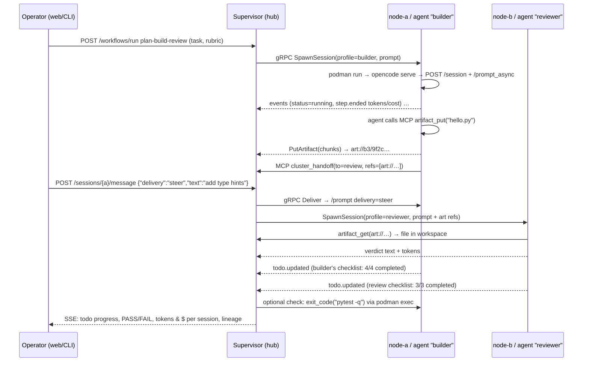

# opencode-cluster — Architecture (v1, after Phase 1)

> Status: Phase 1 implemented and verified end to end (see [`PHASE1.md`](./PHASE1.md)). Phase 0 notes: [`PHASE0.md`](./PHASE0.md). Running it: [`QUICKSTART.md`](./QUICKSTART.md). Config reference: [`CONFIG.md`](./CONFIG.md). Design additions (reviewed): [`PHASE1_5.md`](./PHASE1_5.md) (§12).
> Sections marked **(Phase N)** describe designed-but-not-yet-built parts.

## 1. Goals in one paragraph

Turn OpenCode instances spread across several Linux machines into one cluster you can watch and control. A secret-free **supervisor** on an always-on hub decides what runs where. A small Rust **node daemon** on every machine runs OpenCode sessions inside **rootless Podman containers**. Provider keys stay on the node in a **credential-injecting LLM proxy**, so neither the supervisor nor the agent ever holds a real key. Agents talk to the cluster (send messages, exchange artifacts, spawn sessions) through an **MCP server** that the node daemon provides.

## 2. Components

```mermaid
flowchart LR
  subgraph Operator
    WEB[Web UI<br/>mobile-first SPA]
    TUI[ocl tui / ocl CLI]
  end
  subgraph HUB["Hub machine (always-on)"]
    SUP[supervisor<br/>Rust: axum + tonic]
    DB[(SQLite WAL<br/>state · event log · audit chain)]
    CAS[(Artifact CAS<br/>BLAKE3 blobs)]
    SUP --- DB
    SUP --- CAS
  end
  subgraph NODE["Each node (the hub runs one too)"]
    ND[opencode-node<br/>Rust daemon]
    KP[keyproxy<br/>in-process]
    MCP[cluster MCP<br/>in-process]
    OUT[(outbox SQLite)]
    ND --- KP
    ND --- MCP
    ND --- OUT
    subgraph POD["podman container per session (--network=none)"]
      BR[ocl-bridge<br/>UDS⇄TCP]
      OC[opencode serve]
      BR --- OC
    end
    ND <-->|UDS: /run/ocl/<session>/| BR
  end
  WEB & TUI -->|HTTPS REST + SSE<br/>cookie / API token| SUP
  ND <-->|gRPC bidi stream, node dials out<br/>UDS on the hub · mTLS remote (Phase 2)| SUP
  KP -->|real key injected,<br/>per-agent egress route| PROV[(LLM providers<br/>BYOK + keyless)]
```

| Component | Lang | Responsibility | Budget |
|---|---|---|---|
| `supervisor/` | Rust (tokio, axum, tonic, rusqlite) | Registry of nodes/agents/sessions, orchestration engine (workflows + mailboxes), artifact CAS, evaluator dispatch, operator REST/SSE API, auth, audit log, `/metrics`. **Holds no provider secrets.** | < 60 MB RSS |
| `node-daemon/` (`opencode-node`) | Rust | Reads `~/.opencode-cluster/` (hot reload), manages Podman containers (podman CLI), drives OpenCode over its HTTP API, follows its event bus, runs **keyproxy** and **cluster MCP**, keeps an outbox and replays it after supervisor outages, reconciles on its own restart. | < 40 MB RSS (OpenCode containers excluded; ~420 MB each, measured) |
| `ocl-bridge` | Rust, static musl, ~1 MB | Runs inside each container. Forwards UDS ⇄ loopback TCP in both directions, so the container needs **no network at all**. | negligible |
| `shared-protocol/` | protobuf + Rust crate | gRPC node⇄supervisor envelope + JSON payload enums, REST DTOs, config schema with JSON Schema output (`opencode-node schema`). | — |
| `ui/web` **(Phase 4)** | SolidJS + Vite, static build embedded in supervisor (rust-embed) | Mobile-first dashboard: agents, live tokens/cost, verdicts, task board with drag-to-reorder, node enrollment tokens, artifacts, command bar. | < 150 KB gz |
| `cli/` (`ocl`) ✔ · `ui/tui` **(Phase 4)** | Rust (clap; ratatui) | Same actions as the web UI, for scripting and for SSH-only use. | — |

## 3. Key design decisions

**D1 — Session control uses OpenCode's own server API; the only shim is transport.** Verified against OpenCode **1.19.4** in Phase 1:
- Sessions are created and prompted through the **v1 session API** (`POST /session`, `POST /session/{id}/prompt_async`, `POST /session/{id}/abort`). The newer v2 runner (`/api/session/*`, durable replayable events) does **not expose MCP tools yet** in 1.19.4, and agents need the cluster MCP tools. We switch to v2 once it does.
- Telemetry comes from the v1 instance bus `GET /event`: `session.status` / `session.idle` (busy/idle), `todo.updated`, `message.updated` (per-step `tokens{input,output,reasoning,cache}` and `cost`), tool parts, `permission.*`.
- **Nothing is lost on reconnect:** after every (re)connect the node rebuilds usage, output and todos from `GET /session/{id}/message` and `/todo`. Usage is kept per assistant message id, so replays never double count.
- A message sent while the agent is busy is picked up **at its next step**. That is a native mid-run command.
- Startup quirks handled by the node:
  - config is loaded via `OPENCODE_CONFIG_DIR` (read-only mount, with a pre-created `.gitignore`);
  - `OPENCODE_DISABLE_PROJECT_CONFIG=1`, so an agent cannot rewrite its own permissions;
  - the node waits for its model to appear in `/api/model` before the first prompt.

`ocl-bridge` is the only shim, and it handles transport only. The endpoints we use are listed in `node-daemon/src/oc.rs` and unit-tested against the pinned version's OpenAPI paths.

**D2 — The agent never sees a real key (keyproxy).** You asked for this. Each container's `opencode.json` points every provider's `baseURL` at `http://127.0.0.1:7777/llm/<provider>` (bridge → node UDS). The `apiKey` is a **capability token**: per session, revocable, with a budget. The keyproxy is a header-rewriting reverse proxy that passes the body through unchanged, so OpenAI-compatible, Anthropic and Gemini wire formats all work. For each request it:
1. checks the capability against the session's model allowlist and token/USD budget;
2. reads the real key from the node secret backend;
3. strips the capability and adds the provider's auth (`Authorization`, `x-api-key`, `?key=`, or nothing for keyless gateways);
4. sends the request through the agent's **egress route** (see D10), for example out through another machine so the provider sees that machine's IP;
5. parses usage from the response or stream as a **second, authoritative meter** for budgets.

The supervisor, the UI and other nodes only ever see *secret references* by name.

**D3 — Agents act on the cluster through MCP, not a custom plugin.** The node serves a per-session MCP endpoint (streamable HTTP, reached through the bridge, authenticated by the same capability). OpenCode exposes its tools as `cluster_<name>`:

| Tool | Who |
|---|---|
| `send_message`, `read_inbox`, `list_agents`, `list_sessions`, `session_status` | every session |
| `spawn_agent`, `stop_session`, `task_get`, `task_note`, `task_complete`, `task_fail` | coordinator sessions only (enforced on the node *and* the supervisor) |
| `artifact_put/get/list`, `sync_workspace` | **(Phase 3)** |

This is the "programmatic way" for an agent to start sessions without secrets: it names a **profile**, and the node that owns the key does the rest. OpenCode's native MCP support means nothing has to be compiled into OpenCode. An `agent.tools.cluster` allowlist can narrow the set per profile.

**D4 — Transports, each used where it fits best.**

| Hop | Transport | Why |
|---|---|---|
| node ⇄ supervisor | **gRPC bidirectional stream**, dialed by the node: a 0600 unix socket on the hub (Phase 1) and **mTLS** over TCP for remote nodes (Phase 2) | Typed, multiplexed and small. Commands go down and telemetry goes up on one connection. Works through NAT with no inbound ports on workers. |
| operator ⇄ supervisor | **HTTPS REST/JSON + SSE** | Works in a phone browser, `curl` and the CLI. SSE is enough for one-way live updates. |
| node ⇄ OpenCode | OpenCode HTTP + SSE (`/event`) over UDS | Upstream's native interface. |
| agent ⇄ cluster | MCP (streamable HTTP) over UDS | Native in OpenCode and works with any model. |
| message bus | **None (NATS rejected)** | Hub-and-spoke with one supervisor doesn't need a broker. Fewer daemons on 8 GB machines. NATS is the upgrade path if we ever run several supervisors. |

**D5 — Node identity uses mTLS, bootstrapped by a one-time token.**
1. `ocl node enroll --token <OTT>` creates an Ed25519 key **on the node**.
2. The node sends a CSR, authenticated by a single-use enrollment token that expires after 15 minutes.
3. The supervisor's private CA (rcgen) signs a 30-day certificate whose identity is `node:<name>`. It renews automatically over the live stream at two-thirds of its lifetime.

We chose this over a pre-shared bearer token because:
- the long-lived credential (the private key) never leaves the node;
- TLS gives encryption and identity in one handshake;
- revocation is a single-row CRL check;
- a leaked enrollment token is useless after first use.

The operator UI uses ordinary server TLS (rustls; ACME, or a supervisor-CA certificate the operator trusts).

**Adding a machine from the web UI (Phase 2 + 4), as requested:**
1. In **Nodes → Add machine**, the operator (admin scope, re-authenticated) enters a name and optional labels.
2. The UI shows a one-time join token (single use, 15 min, bound to that node name) and a copy-paste command:
   `curl -fsSL https://hub:7443/join.sh | sh -s -- --token ocl_join_…`, or `opencode-node join https://hub:7443 --token …`.
3. The new machine generates its key locally, sends the CSR with the token, and receives its certificate plus the hub's CA. Then it starts `opencode-node` under systemd.
4. The node shows up as **pending approval** with its key fingerprint. The operator approves it in the UI (optional, on by default), and from then on its agents are eligible.
5. Revoking a node in the UI adds its certificate to the CRL and closes its stream immediately.

Every step is in the audit log. The token is useless after first use or once expired, and a leaked token can only enroll the name it was issued for, which is still subject to approval.

**D6 — Operator authentication uses a password, a cookie and optional TOTP, plus API tokens for the CLI.**
- **Password:** hashed with Argon2id.
- **Session cookie:** `HttpOnly; Secure; SameSite=Strict`, plus a CSRF token on mutations.
- **TOTP:** optional.
- **CLI:** API tokens scoped to `read|operate|admin`.

We chose this over OAuth because there is one trusted operator, everything is self-hosted, and the hub must keep working without an external IdP. Users and roles are already modelled, so OIDC can be added later as a login provider when we go multi-user.

**D7 — Every OpenCode session runs in its own Podman container.** One session per container gives every session a clean identity: its own capability token, MCP identity and budget. The cost is RAM: OpenCode measured **~420 MB RSS idle** per container. Packing several sessions into one container is possible later, but a container cannot tell which of its sessions made an MCP call, so it is not the default. Containers run:
- `--network=none`, `--cap-drop=all`, `--security-opt=no-new-privileges`, read-only rootfs, `--init`;
- rootless with `--userns=keep-id:uid=1000`, or rootful with host dirs chowned to uid 1000;
- with `--memory/--cpus/--pids-limit` taken from config;
- with mounts: workspace, OpenCode home (so sessions survive a container restart), generated config read-only at `/etc/ocl`, and the socket dir at `/run/ocl`;
- with labels `ocl.node`, `ocl.session`, `ocl.agent` for rediscovery.

`container.egress: full` gives an agent normal networking (package installs, webfetch). An allowlisted egress proxy is Phase 5. The image is built from `images/agent/Containerfile`: OpenCode from npm (pinned) plus `ocl-bridge`, git, python3 and pytest. The base image is configurable.

**D8 — Durability works the same way at every level: desired state, observed state, reconcile.**
- **Supervisor restart:** containers keep running, and nodes keep buffering events in their outbox. Each node reconnects with a full **inventory snapshot**, and the supervisor reconciles it against SQLite. Unknown sessions are adopted; missing ones are marked `lost` and may be respawned by policy. **Nothing is orphaned.**
- **Node restart:** the node runs `podman ps --filter label=ocl.node=<me>`, restarts stopped containers, re-attaches gateway and event stream, and resyncs each session from OpenCode's message history. Verified in Phase 1, including a node restart in the middle of a workflow.
- **Outbox:** sequence-numbered and acknowledged by the supervisor. Reconnect uses exponential backoff with full jitter (0.5 s → 60 s).

**D9 — The hub runs its own sessions.** The hub (the always-on machine with the supervisor) also runs `opencode-node`, connected over a local unix socket. Both share the hub's config directory (`supervisor.yaml` + `node.yaml` + `agents/`). Lower the hub's `max_sessions` if it should mostly coordinate.

**D10 — Egress routes: what IP the LLM provider sees.** A *route* only affects the keyproxy's outbound calls to the LLM provider. It doesn't change agent tools or cluster traffic.

```yaml
# routes.yaml
routes:
  direct:      { type: direct }                    # default: this machine's IP
  via-vps-de:  { type: via_node, node: vps-de }    # out through another cluster node
  my-proxy:    { type: proxy, url: socks5h://10.0.0.5:1080 }   # any SOCKS5/HTTP proxy (e.g. `ssh -D`)
```

- **`via_node`** is what you asked for. The calling node opens a CONNECT-style tunnel to `vps-de` over the existing mTLS links (node → hub → `vps-de`, or a direct node-to-node mTLS link if reachable), and `vps-de` opens the TCP connection to the provider. TLS to the provider is **end to end**, so the relay machine sees only encrypted bytes, and the API key stays on the original node. No extra software is needed on the relay; it only needs `relay: true` in its `node.yaml`.
- **`proxy`** points at any existing proxy.
- Routes are chosen per agent (`route:` in the agent YAML), and `node.yaml` can set a node default.
- **(Phase 2)** An agent can list `failover` routes, which keyproxy switches to when the provider quota for the current egress IP runs out. Machines can also join as **relay-only** nodes, admitted by a source-IP allowlist. See PHASE1_5 §3–4.

## 4. Data flow — two-agent handoff (target design)

Phase 1 implements everything here except artifacts (the steps share a workspace instead). Artifacts come in Phase 3, cross-machine placement in Phase 2. The verified Phase 1 run is in [`PHASE1.md`](./PHASE1.md).



## 5. Orchestration model

- **Mailbox.** Every session has a mailbox at the supervisor. There are three delivery modes:
  - `queue` (default): picked up at the agent's next step. This is how an operator changes course mid-run, and it was verified in the demo.
  - `steer`: abort the current step and deliver now.
  - `inbox`: the agent pulls it with `cluster_read_inbox`.

  Messages will carry `art://` references, never file bytes (Phase 3).
- **Workflows.** Workflows are YAML state machines (`steps: build → review`). Each step has an agent profile, a prompt template (`{{input}}`, `{{prev.output}}`, `{{feedback}}`, …), seeded todos, checks, and `next` / `on_fail` transitions. `max_step_runs` bounds review↔build loops. Step state is persisted. All steps of a run share one workspace, so in Phase 1 a run is placed on a node that has every step's agent. Free-form messaging between any two sessions sits alongside workflows.
- **Placement.** A node becomes eligible when it is connected, has the profile installed locally (secret ref resolvable), and has free memory/session slots. Placement can also be pinned with `node:`.

## 5a. Task bucket and the main agent

The operator keeps a **bucket of tasks** (CLI now, web UI in Phase 4) and the cluster works through it.

| Label | When it starts |
|---|---|
| `urgent` | As soon as a task slot is free. One slot beyond `max_concurrent_tasks` is reserved for urgent work, so it never waits behind routine tasks. |
| `when_free` | Only when no task is running **and** every session in the cluster has been idle for `idle_grace_secs`. |
| `on_demand` | Never automatically; the operator presses **Run**. |

- **Order:** within a label, lower `rank` runs first. Sorting in the UI rewrites ranks (`POST /api/v1/tasks/reorder {ids:[…]}`).
- **Starting a task** spawns a **coordinator session** (the `coordinator` agent profile, configurable) on any node that has it. The coordinator:
  - gets the task as its prompt;
  - gets coordinator-only cluster tools;
  - works in a shared workspace named `task-<id>`.
- **The coordinator decides how to split the work.** It calls `cluster_spawn_agent` (optionally sharing its workspace) and is messaged automatically whenever a child finishes a turn. It finishes with `cluster_task_complete(summary)` or `cluster_task_fail(reason)`.
- **Clean-up:** finishing a task stops all of its sessions.
- **A coordinator that stops without finishing** is nudged up to `max_nudges` times, then the task is marked failed.
- **Workflow tasks:** a task tagged `workflow:<name>` runs that workflow instead of a coordinator.
- **The "is the cluster free" decision is deterministic** (the supervisor's scheduler); *how* to do the work is up to the coordinator model.

## 6. Observability

- **Session state** is derived from OpenCode events: `idle` / `running` (step started) / `blocked` (permission or question pending) / `error` (step failed or retry exhausted) / `lost`.
- **Tokens and cost** come from OpenCode's per-step assistant messages. Cost uses OpenCode's figure when it is non-zero, otherwise the `prices` table in `providers.yaml`; keyless gateways cost `$0`. Keyproxy enforces `budget_usd` / `max_tokens` against the same counters. Parsing usage directly from provider responses is Phase 5.
- **Event log:** append-only `events` table (session state changes, tool calls, turn ends, verdicts, task and run transitions). Read it with `GET /api/v1/events` or `ocl events -f`. Daily export to `events-YYYYMMDD.jsonl.zst` is Phase 5.
- **Logs and metrics:** JSON logs (`tracing`, level via `OCL_LOG`). The supervisor's `/metrics` (bearer token) exposes `ocl_nodes_connected`, `ocl_sessions{state}`, `ocl_tokens_total{agent,kind}`, `ocl_cost_usd_total{agent}` and `ocl_tasks{status}`.
- **Audit log:** append-only and **hash-chained** (`h_n = SHA-256(h_{n-1} ‖ length-prefixed fields)`) for every control action: who (operator token name, `session:<id>` for agent tool calls, or `system`), what, target and result. `ocl audit --verify` checks the chain, and a unit test proves tampering is detected.

## 6a. Success tracking with todo lists

OpenCode agents already keep a todo list (the built-in `todowrite` tool). Each item has `content`, `status` (`pending|in_progress|completed|cancelled`) and `priority`. Every change produces a durable `todo.updated` event, which the node forwards. On top of that:

- **Per-session progress** is shown in the dashboard, for example `builder ▓▓▓░ 3/4`, with the item currently `in_progress` shown as the session's *current task*.
- **Task board.** A workflow step (or the operator) can *seed* a checklist: `success.todos: ["module written", "tests pass", "artifact published"]`. These items are injected into the agent's prompt as the todos it must keep. The supervisor rolls the results up across all sessions working on one task, so you see one shared board.
- **Verdict rule, configurable per step:**
  - **PASS** means the session is idle, every seeded todo is `completed`, no todo is left `pending` or `in_progress`, and any optional hard checks pass.
  - **FAIL** means a seeded todo was `cancelled`, the session errored, or a hard check failed.
  - **INCOMPLETE** means the session went idle with open items. The workflow can re-prompt ("continue with your open todos") up to `max_nudges` times.
- **Optional hard checks** (`exit_code`, `test`, `regex`, `exec`) guard against an agent ticking boxes it didn't actually finish. The demo uses `pytest -q`.
- **Sharing todos between agents.** `cluster_session_status` returns another session's todo list, so a reviewer or coordinator can see what a builder claimed to finish. A per-task rolled-up board is part of the Phase 4 UI.

## 6b. Workspaces (configurable: isolated or shared)

```yaml
workspace:
  mode: isolated        # isolated | shared
  name: demo-project    # shared: agents with the same name share it
  seed: art://b3/…      # optional: start from an artifact (git bundle / tar)
```

| Situation | What happens |
|---|---|
| `isolated` | Each agent gets its own Podman volume. Files move only as artifacts. Lineage is clean. |
| `shared`, both agents on the **same node** | The same named Podman volume is mounted into both containers. Changes are visible immediately and nothing is copied. Agents should coordinate through messages or todos to avoid editing the same file at once. Optionally, `lock: advisory` adds `cluster_lock(path)` MCP tools. |
| `shared`, agents on **different nodes** | A volume can't be shared across machines. The workspace is instead **synced through the artifact store**: at each handoff (or `cluster_sync`), the source node snapshots the workspace as a git bundle (or `tar.zst` for non-git trees) and publishes it as an artifact. The target node applies it into its copy of the volume. Lineage is recorded. Conflicts surface as git merge conflicts for the agent to resolve. |

**No `podman cp` or SCP.** The node daemon owns the volumes on the host side, so it reads and writes workspace files directly, and every cross-container transfer goes through the node's CAS cache:
- **Same node:** a hard link or reflink from the cache, which is instant. Metadata is still recorded at the hub.
- **Different node:** chunked upload to the hub, then download to the target.

Agents use `artifact_put/get` or `cluster_sync`, and the operator uses `ocl artifact put/get/ls`.

## 7. Artifacts

- **Storage:** content-addressed with BLAKE3, held as blobs on the hub filesystem by default. A swappable backend is available through the `object_store` crate (S3/Garage/MinIO).
- **Metadata:** in SQLite, covering name, media type, size, producer session, parent refs (**lineage**) and tags.
- **Transfer:** chunked streaming over the gRPC connection, so there are no direct node-to-node copies. Nodes cache blobs by hash.
- **Code trees:** a git bundle is the artifact type to use. `ocl artifact get` can unbundle it into a workspace.

## 8. Pluggability

- **Providers** are declarative entries in `providers.yaml` (`base_url`, `auth: bearer|header:<name>|query:<name>|none`, price table, model list). The defaults ship OpenRouter, Groq, Gemini, Anthropic, OpenAI, Kilo (via OpenKilo's keyless free-model endpoint) and Pollinations/KeylessAI.
- **Success checks** implement one Rust trait. The primary signal is **todo completion** (§6a). Optional built-ins are `exit_code`, `test` (command + JUnit/TAP parse) and `file_exists/regex`. Third-party checks can be any executable speaking a JSON stdin/stdout protocol (`kind: exec`). An LLM judge is deliberately left out of v1; it can be added later as an `exec` check.

## 9. Reuse vs. build — evaluation matrix

| Need | Candidate | Verdict | Rationale |
|---|---|---|---|
| Session control | **OpenCode `serve`** (1.19.4): v1 session API + `/event` bus | ✅ **Reuse** | Prompt, abort, todos, per-step tokens/cost and permission events. v2 (durable replay) lacks MCP tools in 1.19.4, so we adopt it later. No upstream changes needed. |
| Client for that API | `@opencode-ai/sdk` (TS/Go) · `opencode-codes` (Rust, unofficial) | ⚠️ Small hand-written client (~250 lines) | The daemon must be Rust. Generators choke on the 480 KB OpenAPI 3.1 doc, and `opencode-codes` is self-described "highly untested". Our client's endpoints are unit-tested against the pinned OpenAPI paths. |
| Agent → cluster tools | MCP (native in OpenCode) vs. a custom TS plugin | ✅ **Reuse MCP** | No OpenCode plugin to maintain, so nothing breaks across OpenCode versions. |
| In-session subagent orchestration | oh-my-opencode, oh-my-opencode-slim, opencode-workspace | 🔁 **Complementary, optional per profile** | They orchestrate *inside* one session. We orchestrate *across* sessions and machines. A profile may list them as plugins; we don't depend on them. |
| Cross-agent control plane plugin | opencode-multiagent | ❌ Reject | Removed from npm. Single-process only. |
| Telemetry | opencode-plugin-otel (devtheops), @gcornut/opencode-otel | 🔁 **Optional** | We already get tokens and cost from durable events. Enable the plugin if you also want OTLP sent to Grafana or SigNoz. |
| Token debugging | opencode-tokenscope | 🔁 Runbook tool | Useful for post-mortems on a single session. |
| Credential-injecting LLM proxy | LiteLLM proxy | ❌ Build (thin, in Rust) | LiteLLM is Python with a 300 MB+ footprint and far more features than we need. Ours is a header-rewriting pass-through of a few hundred lines, inside `opencode-node`. |
| Keyless: Kilo | **OpenKilo** | ✅ Reuse its endpoint as a provider template | Free models through Kilo's gateway with no key. Routing it through keyproxy keeps metering and egress routing the same as for BYOK providers. |
| Keyless: Pollinations | gen.pollinations.ai `/v1` (direct) · KeylessAI worker | ✅ Pollinations direct (token optional) · ⚠️ KeylessAI as best-effort fallback | KeylessAI is a third-party Cloudflare worker with no SLA. The legacy `text.pollinations.ai/openai` endpoint is deprecated. |
| Containers | **Podman** (rootless or rootful) driven via the podman CLI | ✅ Reuse | Daemonless, works with systemd. The CLI keeps us independent of libpod API versions. Quadlet units for the daemons come in Phase 5. |
| Agent image | Our `images/agent/Containerfile`: OpenCode from npm (pinned) on a configurable base | ✅ Thin build | The upstream GHCR image works too. Building from npm keeps one pinned version for both the image and the API test fixture. |
| Message bus | NATS / Redis | ❌ Reject (v1) | See D4. |
| Overlay network | Tailscale/Headscale/WireGuard | 🔁 Optional | Not required, because nodes dial out over mTLS. |
| Success tracking | **OpenCode's built-in todo list** (`todowrite` tool, `todo.updated` event, `GET /session/{id}/todo`) | ✅ Reuse | Agents already keep todo lists. We just collect and roll them up, so nothing new needs to be taught to the model. |
| Egress relay | SSH `-D`, tinyproxy, Squid | 🔁 Optional | `via_node` covers the common case with no extra software. An external SOCKS/HTTP proxy is supported for anything else. |
| Web UI framework | SolidJS (operator choice) | ✅ | Fine-grained reactivity suits a live token/status dashboard. Small bundle, good on phones. |
| Secrets at rest | systemd-creds (`LoadCredentialEncrypted`), `pass`, env, file; SOPS+age for git-committed configs | ✅ Reuse | Never invent crypto storage. |
| Storage | SQLite (WAL) | ✅ Reuse | One file, no extra daemon, plenty for about 10k events/minute. |

## 10. Security summary

| Asset | Where it lives | Who can see it |
|---|---|---|
| Provider API keys | Node secret backend | `opencode-node` keyproxy **only**. Never the supervisor, the UI or the container. |
| Capability tokens | Container `opencode.json` | That agent. Scoped to its session, budget-capped, revoked when the session ends. |
| Node private key | Node `0600` file or systemd-cred | That node. |
| Operator API tokens | Supervisor DB, SHA-256 hashed, scoped `read`/`operate`/`admin` | Shown once at creation. |
| Operator password | Supervisor DB (Argon2id) **(Phase 4)** | — |

- Network hops: same-machine links use 0600 unix sockets. Remote nodes will use mTLS (Phase 2) and the UI server TLS (Phase 4). Until then, keep `api_listen` on loopback or put a TLS reverse proxy in front; the supervisor warns otherwise. Container↔node traffic stays on the host over UDS.
- Verified from inside an agent container in Phase 1:
  - the real key appears nowhere in its env or config;
  - there is no network at all;
  - a forged capability gets 401;
  - requesting another model gets 403;
  - the config is read-only;
  - all capabilities are dropped.
- Every mutating API call goes through RBAC (operator/admin), then the audit chain.

## 11. Repository layout

```
opencode-cluster/
  shared-protocol/   proto/link.proto; src/{config,model,link,api}.rs
  supervisor/        src/{main,api,link,state,orch,db}.rs
  node-daemon/       src/{main,cfgstore,manager,oc,gateway,link,runtime,secrets,store}.rs
  bridge/            ocl-bridge (static musl)
  cli/               ocl (clap)
  ui/                web (SolidJS) + tui (ratatui) — Phase 4
  images/agent/      Containerfile
  examples/          quickstart/ (hub config + run-local.sh), mock-llm/ (scripted OpenAI-compatible mock)
  docs/              ARCHITECTURE, PHASE0, PHASE1, QUICKSTART, CONFIG (RUNBOOK: Phase 4)
```

## 12. Additions designed after Phase 1 (see [`PHASE1_5.md`](./PHASE1_5.md))

| Area | Summary | Phase |
|---|---|---|
| Templates → instances | Hub template library, secret aliases resolved per node, `overridable` caps, spawn from UI/CLI/MCP | 2 |
| Egress IPs and quotas | Per-IP / per-key / per-account buckets, learned from provider headers and 429s, reset countdowns, failover routes, `parked` state | 2 |
| Relay-only nodes | Proxy machines with no agents, admitted by an allowlist editable in the UI | 2 |
| Placement | Scored using capacity, quota headroom, measured latency and locality, with an explained decision | 2 |
| Questions | Questions escalate up the parent chain; an operator mode decides what reaches you; assumption log | 3 |
| Death and cleanup | `dead` reasons, cost-aware retry/reassign/halt, harvest of outputs on every exit | 3 |
| UI | SolidJS + Tailwind + Kobalte, dark/light, colour+icon status encoding, Open in OpenCode on a second port of your domain, notifications incl. Web Push, password login on your domain | 4 |
| Containers | Live CPU/RAM/pids/disk per instance, soft or hard disk limits | 2 / 5 |
