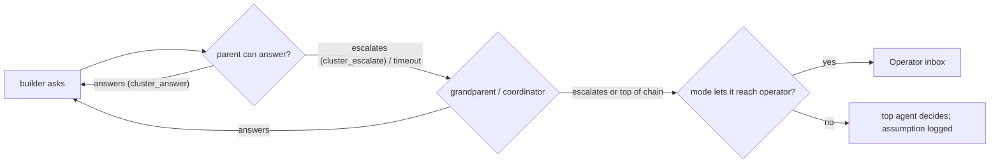

# Phase 1.5 — Design additions before Phase 2

> Status: **design reviewed** (2026-10-23; decisions in §15). No code yet.
> Covers the requirements added after Phase 0 that ARCHITECTURE.md does not yet describe. Each section names the phase that builds it (§14).
> Builds on: keyproxy (D2), cluster MCP (D3), mTLS links (D5), egress routes (D10), task bucket (§5a).

## 0. Re-verification of Phase 1 (2026-10-23)

Re-ran on a fresh machine (no Podman available there, so with `runtime: process` and OpenCode 1.19.4): build clean, 9/9 unit tests, `run-local.sh --with-worker` passes — workflow **Passed** (build → review), task #3 **done**, mid-run docstring present, audit chain OK. Two findings:

| Finding | Action |
|---|---|
| With `runtime: process`, workflow checks run on the host, so `python3 -m pytest` fails unless pytest is installed there. The first run reported `build:Fail` for that reason only. | QUICKSTART now says so. Phase 2: `opencode-node check` warns when a check's command is not on the host's `PATH` under `runtime: process`. |
| In one of two runs, the builder that got the mid-run message stayed `idle` after its task finished instead of `stopped`. Looks like a race between "task complete → stop sessions" and the queued message starting a new step. | Phase 2 bug: stop must apply to sessions spawned by the task even when a step starts after the stop is issued. Add a regression test. |

Container isolation was not re-checked on that machine (Phase 1 evidence stands).

## 1. Vocabulary

| Term | Meaning |
|---|---|
| **Template** | An agent profile (`agents/<name>.yaml` or the hub library, §2). Says *what* an agent is. |
| **Instance** | One running copy of a template: a session in its own Podman container. The UI and API say "instance"; the code keeps `session`. |
| **Egress IP** | The public IP an LLM provider sees for a request. Set by the route. Several instances, even on different machines (`via_node`), can share one. |
| **Bucket** | One quota counter: (provider, scope, scope id), e.g. (`kilo-free`, ip, `203.0.113.7`) or (`openrouter`, account, `personal`). |
| **Chain** | The line from an instance up to the operator: `builder → coordinator(task #3) → operator`. Questions and reports travel along it. |

## 2. Templates and on-demand instances

Agent YAMLs already behave as templates. Three additions make them usable by the operator **and** by the super-agent:

```yaml
# hub: templates/py-builder.yaml   (or node: agents/py-builder.yaml)
apiVersion: ocl/v1
kind: Agent
name: py-builder
provider:
  id: openrouter
  model: qwen/qwen3-coder
  key: { secret: openrouter }      # NEW: a secret ALIAS, resolved by each node (node.yaml `secrets:`)
instances:
  max: 4                           # cluster-wide cap for this template
  placement: { labels: { gpu: "no" } }
overridable:                       # what a spawner may change, with caps
  role.append: true                # extra instructions for this instance
  limits.budget_usd: { max: 2.00 }
  route: [direct, via-vps-de]
  workspace: true
outputs:                           # what to keep when the instance ends (§9)
  - { glob: "**/*.py", to: parent_workspace }
  - { transcript: true, to: artifact }
```

```yaml
# node.yaml
secrets:
  openrouter: { ref: "systemd-creds:openrouter", account: personal }   # account groups usage across nodes
```

- **Hub library:** `templates/` on the hub is pushed to nodes on connect. A node offers a template only when it can resolve every secret alias. The key itself still never leaves that node.
- **Spawning:** `POST /api/v1/instances {template, node?, overrides, parent?, task?}`, `ocl spawn`, the web UI's **New instance** sheet, and the MCP tool `cluster_spawn_agent(template, prompt, overrides)`. Overrides outside `overridable` are rejected and audited.
- **Warm pool (Phase 5):** `instances.warm: 1` keeps one booted container per template, which hides the ~35 s cold start.

## 3. Egress IPs, quotas and reset times

### 3a. Knowing which IP each instance uses

| Route type | How the node learns the egress IP | Third-party call? |
|---|---|---|
| `direct` | The hub reports the source address of the node's mTLS connection. | No |
| `via_node` | Same, for the relay node. | No |
| `proxy` (SOCKS/HTTP) | An echo request through the proxy (`ip_echo:` list, default `https://api.ipify.org`), on start, every 30 min and on route change. | Yes, configurable |

Routes can pin `ip_family: v4|v6`. Without that, a dual-stack machine may reach a provider over IPv6, and the counts would land in the wrong bucket. The supervisor stores `(node, route, family) → ip, observed_at, source`. Two nodes behind one NAT therefore show up as one IP.

### 3b. Quota model

```yaml
# providers.yaml
providers:
  kilo-free:
    quota:
      scope: ip                     # ip | key | account
      limits:
        - { kind: requests, max: 200, window: { fixed: 1d, at: "00:00", tz: UTC } }
        - { kind: tokens, max: 1000000, window: { rolling: 5h } }
      learn: [headers, http_429]    # trust the provider's own signals over this config
  openrouter:
    quota: { scope: account, learn: [headers, http_429, usage_api] }
```

Live overrides set in the web UI or in `node.yaml` win, e.g. "this bucket on `vps-de` resets at 03:15 UTC" or "it has 40 requests left".

**Where the numbers come from, best first:**

1. **Provider signals.** Keyproxy sees every request and response:
   - rate-limit headers (`x-ratelimit-remaining-*` / `x-ratelimit-reset-*` on OpenAI-compatible APIs like Groq; `anthropic-ratelimit-*-reset`);
   - `Retry-After` and 429 bodies (for example Gemini's `RetryInfo.retryDelay`);
   - account endpoints where they exist (OpenRouter's key endpoint returns usage and limits).
2. **Operator config and live overrides** (above).
3. **Counting.** Keyproxy counts requests and tokens per bucket itself.

The parsers are pluggable per provider, like the success checks (§8 of ARCHITECTURE). Keyless gateways (Kilo, Pollinations, KeylessAI) document little, so for them the 429s the cluster hits are the main signal. After a 429, the node records the window it observed, and the UI shows that value as *learned*.

**What the UI shows:**
- **Providers page:** a row per bucket, with used/max, a bar, `resets in 3h 24m`, the source (`header`/`429`/`config`/`learned`), and the instances using it.
- **Keyless providers:** buckets grouped **by egress IP → nodes → instances**. This answers "who shares this IP".
- **Agent cards:** which bucket each agent is drawing from right now.

### 3c. Failover to another IP when an allowance runs out

```yaml
# agent template (or set live in the UI)
route:
  prefer: direct
  failover: [via-vps-de, home-proxy]     # tried in order when the current bucket is exhausted
  on_exhausted: wait                     # wait (park until the soonest reset) | fallback_provider | fail
```

- **When it switches:** keyproxy picks the first route whose bucket for this provider has headroom. It switches before sending, so a known-exhausted bucket is never hit.
- **429 mid-flight:** if a request gets a 429 before any byte reaches OpenCode, keyproxy retries it once on the next route. OpenCode never sees the error. Once streaming has started, the request is not retried.
- **Stickiness:** the instance stays on the new route until the original bucket resets, then moves back.
- **Visibility:** each switch is an event (`route.failover`). The agent card shows `↪ via vps-de (direct exhausted, resets 03:15)`.
- **`wait`:** the instance shows **parked** with the countdown and resumes by itself. Its parent is told, so it can reassign the work.
- **Live changes:** route edits made in the web UI go into a node-local `overrides.yaml`. It is git-ignored and hot-reloaded, so your versioned YAML is never rewritten behind your back. **Promote to YAML** in the UI writes the change into the template file.

## 4. Proxy-only machines and the source allowlist

- **Proxy-only node:** `node.yaml: role: relay`. It runs `opencode-node --relay-only`, with no Podman and no agents, at about 10 MB RSS. It dials out to the hub like any node and serves `via_node` tunnels. It automatically becomes a route `via-<name>`, which any agent can list in `failover`.
- **Allowlist:** enrollment and every relay connection are checked against **allowed source CIDRs**. They are seeded from `supervisor.yaml: enrollment.allowed_sources` and then edited in **Nodes → Allowed IPs** (admin scope, re-authentication, audited).
  - A relay machine whose IP drops off the list is disconnected, and its routes are marked unavailable.
  - The same list can optionally apply to all nodes (`enforce_for: relay | all`).
- **External proxies:** proxies from `routes.yaml` (SOCKS/HTTP, credentials by secret ref) are listed on the same page, with their egress IP, latency and health. Proxy routes can be added from the UI; the route lands in the node's `overrides.yaml`, and any credential stays a secret ref on that node.

## 5. Link and latency awareness for placement

**What is measured, cheaply:**

| Link | Method | Cost |
|---|---|---|
| node ⇄ hub | RTT from gRPC keepalive pings | free |
| node ⇄ relay / proxy | RTT from tunnel setup, plus an optional 1 MB throughput probe every 30 min (`probe_throughput: false` on metered links) | small |
| node → provider, per route | Passive, from real requests: time to first token, tokens per second, error rate | free |
| node ⇄ node | RTT through the hub, plus measured artifact transfer rates | free |

These are stored as p50 and p95 values over 1 h, in a `link_metrics` table.

**Placement** applies hard filters first:
- the template is available and its secrets are resolvable;
- memory, disk and session slots are free;
- unless `on_exhausted: wait` is allowed, at least one route has quota headroom.

It then **scores** the remaining candidates:

```
score = 0.30·capacity + 0.25·quota_headroom + 0.20·provider_latency(route)
      + 0.15·locality (parent / workspace / artifacts on that node) + 0.10·hub_link
```

The weights are set in `supervisor.yaml`. Every decision emits `placement.decided`, with each candidate's score and the reason the winner won ("vps-de: 2.1 s TTFT to Groq vs 4.8 s, 180 requests left"). The UI shows that reason on the instance.

The super-agent sees the same data through `cluster_list_nodes`, so a coordinator can say "put this on the fast box" and get an explainable result.

## 6. Questions, escalation and upward communication

### 6a. Sources

- **OpenCode's own `question` tool.** 1.19.4 has `/question` and `/question/{id}/reply|reject`. Phase 1 handles only permissions, so the node will also intercept question requests.
- **`cluster_ask(question, options?, importance, context)`.** A new MCP tool, for questions an agent wants answered by its chain.
- **`ask` permission requests,** shown as questions of kind `permission`.
- **`cluster_report_up(message)`.** Not a question: a status report to the parent. The existing "child finished a turn" message becomes one case of this.

### 6b. Routing



1. A question goes first to the asker's **parent** as a message carrying a question id. The parent either answers with `cluster_answer(id, answer)` or escalates with `cluster_escalate(id, note)`; the note adds context for whoever is next.
2. Escalation repeats up the chain. A holder that does nothing for `answer_timeout` (default 5 min) escalates automatically.
3. At the top, the **question mode** decides whether it reaches you. If it doesn't, the top agent must decide, and the decision is written to the task's **assumption log** for you to review later.
4. While a question is open, only the asker's own branch is `blocked`. Siblings keep working.

### 6c. Modes

Set globally, per task, or per workflow run; switchable live.

| Mode | What reaches you |
|---|---|
| `ask_me_everything` | Every question, immediately. Agents in the chain see it but do not answer. |
| `important_and_vital` *(default)* | `normal` and `vital` questions the chain could not answer. `low` stays inside the chain. |
| `vital_only` | Only `vital` questions, after the chain fails. |
| `autonomous` | Nothing, except what no agent is allowed to decide: granting a permission the template denies, secrets, and spending past a budget. Everything else goes into the assumption log. |

**Importance:**
- Each agent tags its own questions.
- **Rules can raise the level but never lower it.** Anything about spending money, credentials, deleting data, irreversible or external actions, or a permission outside the template becomes `vital`.
- The preamble (§10) tells agents what each level means.

### 6d. The operator's question inbox

Questions are sorted by:
1. importance;
2. how many instances are blocked on it;
3. age.

Each card shows:
- the full chain (`builder s-e05… on worker-a → coordinator task #3`);
- the node, and the task or run;
- the question and its options;
- the escalation notes added on the way up;
- what is blocked.

Answer in place (choices as buttons, free text, or "let the agent decide"). The answer goes straight to the asker, and every agent that escalated it sees it too. The inbox is also exposed as `GET /api/v1/questions` and `ocl questions` / `ocl answer`.

## 7. Health: dead agents, offline machines, provider status

| Thing | States | Detected by |
|---|---|---|
| Instance | adds **`dead`** (reason: `oom`, `exit:<code>`, `crashloop`, `wall_clock`, `node_lost`) and **`parked`** (waiting on quota) | `podman inspect` (`State.OOMKilled`, exit code), restart count, node loss after `disconnect_grace_secs` |
| Node | `online` / `degraded` (high load, low disk, stale stats) / `offline` (no heartbeat for 30 s) | heartbeats and host stats |
| Provider, per node and route | `ok` / `slow` / `rate_limited` (with reset time) / `auth_failed` / `down` | passive error and latency stats from keyproxy, plus a light `GET /models` probe only when idle and that provider allows it |

Every state change is an event, can trigger a notification (§11), and shows in the UI's status strip.

## 8. When an agent dies: retry, reassign or halt

When an instance dies, the supervisor works out what each recovery would cost, using the task subtree's spend so far and the template prices:

| Option | Estimated extra cost |
|---|---|
| **Restart in place.** Same node, same OpenCode home, history intact. Only if the node is alive. | Re-reading the context: last context size × input price |
| **Resume elsewhere.** From the latest checkpoint: the transcript and workspace snapshot the node sends to the hub every few turns (Phase 3 artifacts). | Context size × the new provider's price, plus workspace sync time |
| **Hand off to a fresh agent.** The parent writes a summary. | `handoff_factor` × spend so far (default 0.5) |

```yaml
# supervisor.yaml (overridable per task / template)
on_death:
  auto_retry: 1                 # cheapest option, at most once
  max_auto_cost_usd: 0.50       # above this, or…
  max_auto_fraction: 0.25       # …above 25% of what the task has spent, halt instead
  keyless_quota_fraction: 0.25  # same idea for $0 providers, measured in quota left
```

**Halt** means:
1. Every running instance in the task's tree is interrupted at its current step.
2. Workspaces are snapshotted and harvested (§9).
3. The containers stop but are **kept**.
4. The task becomes `halted`.
5. You get a notification with the death reason, what was in progress (the current todo), the spend so far, and the three options with cost estimates, plus **Abandon**. One tap resumes.

## 9. Cleanup and output harvesting

Instance lifecycle: `running → stopping → harvesting → stopped → reaped`.

- **Harvest** runs on stop, kill, task end **and death**. The node owns the volumes on the host side, so it can harvest from a dead container. Harvesting:
  1. resyncs tokens and todos one last time;
  2. copies the template's `outputs:` to their destinations: `parent_workspace`, `task_workspace`, `artifact` (with lineage), or a named path;
  3. exports the transcript as an artifact if asked;
  4. revokes the capability token;
  5. records a `harvest` event listing what went where.
- **Reap** removes the container, and the volume per `retain:`. The default keeps isolated volumes for 24 h; `retain: on_failure` keeps them only after a failed run.
- **Node lost:** harvesting is impossible, so the latest checkpoint is used. The UI marks any outputs written after it as **unrecoverable**.

## 10. Preamble

Every instance's prompt starts with a layered preamble. Layers are applied in this order, later ones adding to earlier ones:

1. `preambles/cluster.md` on the hub (pushed to nodes);
2. `role.preamble` in the template;
3. the task's or run's preamble;
4. the spawner's `role.append`.

It is rendered with variables such as `{{instance.id}}`, `{{template}}`, `{{node}}`, `{{parent}}`, `{{task}}`, `{{question_mode}}`, `{{budget}}`, `{{outputs}}` and `{{tools}}`. The shipped default tells the agent:
- who it is and who it answers to;
- how to use `cluster_*` tools;
- when to `report_up`;
- how to ask questions, given the current mode;
- its budget and the effect of quota parking;
- where its outputs go.

The UI shows each instance's rendered preamble under **What it was told**.

## 11. Notifications

- **Events:**
  - task or run completed / failed / halted;
  - instance dead;
  - question waiting (by importance);
  - quota exhausted or reset;
  - node offline or back;
  - provider `auth_failed` or `down`;
  - budget at 80%.
- **Channels:**
  1. the in-app notification centre: SSE, with an unread badge;
  2. **Web Push** (VAPID). The UI is a PWA, so this works on a phone with the tab closed, including on iOS once it is added to the home screen;
  3. optional `ntfy` topic or webhook.
- **Rules:** per event type and severity, with quiet hours. `vital` questions and halts ignore quiet hours.

## 12. Containers: resource tracking and limits

- **Per instance**, every 10 s: `podman stats` (CPU %, memory used/limit, pids, block I/O) for the node's `ocl.session` containers in one call. Every 60 s: workspace and home disk usage. Also restart count, OOM kills and uptime.
  - Stats stream as a downsampled time series: 10 s for an hour, then 1 min for 7 days.
  - **Host totals** are reported too: RAM, disk, load and reserved headroom.
- **Limits** in the template:
  - Memory, CPU and pids are set as today.
  - **New: `container.disk: 5g`.** It is soft by default: at 90% the agent gets a message and you get a notification; at 100% the instance is interrupted (halt policy). It is **hard** on rootful Podman over XFS project quotas or btrfs qgroups (`disk_enforce: hard`). Rootless Podman cannot mount size-limited volumes, so it stays soft there.
  - **New: `container.tmp: 512m`,** a size-limited tmpfs at `/tmp`.
- **Placement** reserves memory, disk and session slots against these limits before starting an instance.

## 13. Operator UI

### 13a. Stack

| Choice | Why |
|---|---|
| **SolidJS** + Vite | Already decided. Live token counters and statuses update dozens of times a second; Solid's fine-grained signals update only the changed text nodes, with no virtual-DOM diff. The runtime is about 7 KB. |
| **Tailwind CSS v4** (Vite plugin) | No hand-written CSS, as requested. Design tokens live in a `@theme` block. Dark mode uses the `dark:` variant on a `.dark` class: it follows the system setting, with a toggle that is remembered. |
| **Kobalte** | Accessible headless primitives for Solid: dialog, sheet, menu, tabs, toast, combobox. Styled with Tailwind. |
| `lucide-solid` icons | Shapes go with colours, so a status never relies on colour alone. |
| `@solid-primitives/*` | SSE, storage, media queries. |

The bundle budget stays below 150 KB gzipped. Pages are built mobile-first: bottom tab bar on phones, sidebar from `md:`.

### 13b. Showing information with colour, and not only colour

| Signal | Encoding |
|---|---|
| Instance status | running = emerald with a pulsing dot · idle = slate · blocked/question = amber with a `?` badge · parked = sky with a clock · error = red · dead = red with a cross and a striped card · stopped = grey. Each also has an icon and a text label. |
| Where it runs | Each node gets a stable hue, derived from its name and checked for contrast in both themes. Shown as the card's left border and the node chip. Relay nodes have an outline-only chip. |
| Egress IP | An IP chip, with a link icon when the IP is shared and a count of its sharers. |
| Quota | The bar goes green → amber at 70% → red at 90%, with the reset countdown next to it. |
| Provider tier | `best_effort` providers get a dashed border. |

### 13c. Views

- **Overview:** status strip (nodes, providers, open questions, halts), then live instances grouped by node.
- **Instances:** filter or group by node, egress IP, template, task or status. The detail page shows:
  - tokens and cost over time;
  - todos;
  - container stats;
  - the chain;
  - rendered preamble;
  - placement reason;
  - message box (queue/steer);
  - **Open in OpenCode** (§13d).
- **Questions:** the inbox from §6d.
- **Providers & quotas:** buckets by provider, with a by-IP grouping for keyless providers, countdowns and overrides.
- **Tasks / Workflows:** board with drag-to-reorder, runs, verdicts, halted tasks with recovery options.
- **Templates:** list, and **New instance**.
- **Nodes & proxies:** health, host stats, link metrics, **Add machine** (join token), **Allowed IPs**.
- **Artifacts, Notifications, Audit.**
- **TUI** (`ocl tui`, ratatui): the same core views over the same API.

### 13d. Open an instance in OpenCode's own web UI

Verified on 1.19.4: `opencode serve` serves OpenCode's web app at `/`, with assets embedded in the binary. It works with no network, which agent containers need. Its asset paths are absolute (`/assets/…`), so it **needs its own origin** and cannot run under a sub-path.

- **URL:** the same domain as the dashboard on a second port, `https://<your-domain>:7444/` (`attach_listen` in `supervisor.yaml`). A different port is a different origin to the browser, so OpenCode's absolute paths work. It reuses the dashboard's certificate, so **no DNS changes are needed**. If your host only allows port 443, use one extra ordinary subdomain such as `oc.<your-domain>` instead.
- **Opening it:**
  1. **Open in OpenCode** calls `POST /api/v1/instances/{id}/attach`, which returns a one-time ticket that expires in 60 s.
  2. The attach origin exchanges the ticket for an `HttpOnly` cookie, valid for 8 h, that says which instance to show.
  3. One browser shows one attached instance at a time. Clicking **Open in OpenCode** on another instance switches to it.
- **Traffic path:** the browser talks to the supervisor; the supervisor uses a **tunnel stream** on the node's gRPC link; the node goes over UDS through `ocl-bridge` to `opencode serve`. The node adds the container's OpenCode password, so the password never reaches the browser. The `via_node` relays use the same tunnel mechanism.
- **While attached:** telemetry continues, since the node still follows `/event`. What you type is just another prompt. The card shows `attached by operator`, and the attach is audited.
- **Terminal:** `ocl attach <instance>` forwards a local port through the same tunnel and runs `opencode attach http://127.0.0.1:<port>`.

### 13e. Hosting and login on your domain

- **TLS:** the supervisor gets a normal certificate for your domain itself (ACME HTTP-01 through `instant-acme`, the same mechanism Let's Encrypt uses for any website). The only DNS needed is the record pointing your domain at the hub, which you need anyway. You can also bring your own certificate. Running behind Caddy or nginx is also supported (`api_listen` on loopback, `trusted_proxy`).
- **Login:** any page without a valid cookie redirects to `/login` and asks for the password (Argon2id). D6's cookie settings and CSRF protection apply, plus optional TOTP. Failed logins are rate-limited per IP and per account, with backoff and lockout notifications. Every login and logout is audited.

## 14. Where each item lands

| Phase | Adds (beyond the original plan) |
|---|---|
| **2** — remote | mTLS enrolment with the **source allowlist**; **relay-only nodes**; generic **tunnel stream** (used by `via_node` and later attach); **egress IP discovery**; **quota buckets** with header/429 learning, **failover routes**, `parked`; **link metrics** + scored placement; hub **template library** + secret aliases + `overridable`; **preamble**; container and host stats; the two Phase 1 fixes from §0 |
| **3** — artifacts + success | **Harvest/cleanup** with `outputs:`; checkpoints; **death detection + retry/reassign/halt**; **questions and escalation** (`cluster_ask/answer/escalate/report_up`, OpenCode question interception, modes, assumption log) |
| **4** — UI | SolidJS + Tailwind + Kobalte UI with dark/light, all views in §13c; **Open in OpenCode**; **notifications** (in-app, Web Push, ntfy); TLS/ACME on your domain; password login; UI editing of routes, quotas and allowlist through `overrides.yaml`; TUI |
| **5** — hardening | Hard disk quotas; warm pool; load test with 10 instances, including quota-exhaustion and failover runs; chaos tests for halt (kill a node mid-task) |

**Protocol additions** (`shared-protocol`):
- **Node → hub:** `EgressIp`, `Quota`, `ContainerStats`, `HostStats`, `LinkSample`, `Question`, `Died{reason}`, `Harvested`.
- **Hub → node:** `TunnelOpen` / `TunnelData` / `TunnelClose`, `RouteOverride`, `QuotaOverride`, `Answer`, `Halt`, `Harvest`, `TemplateSync`.

**New supervisor tables:** `egress_ips`, `quota_buckets`, `link_metrics`, `questions`, `assumptions`, `notifications`, `push_subscriptions`, `allowed_sources`, `container_stats`, `harvests`.

## 15. Decisions (operator review, 2026-10-23)

| Question | Decision |
|---|---|
| How to reach OpenCode's web UI | **Keep it simple:** a second port on the same domain, no DNS changes (§13d). |
| Question modes and default | **Accepted:** the names in §6c, default `important_and_vital`. |
| Hub template library with secret aliases | **Accepted** (§2). |
| Death policy | **Accepted as the default:** auto-retry once, halt above $0.50 or 25% of spend (§8). |
| Disk limits | **Soft by default** (§12): the node watches disk use, warns at 90% and stops the agent at 100%. Hard limits are opt-in for machines whose filesystem supports them. |
